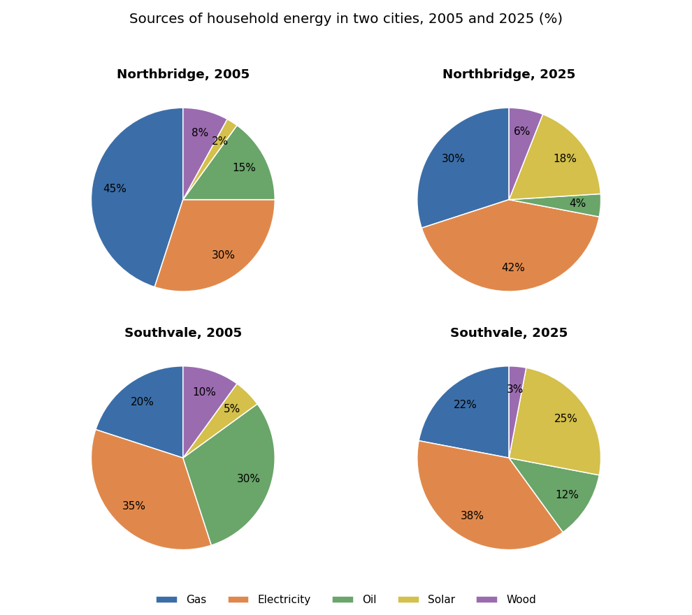
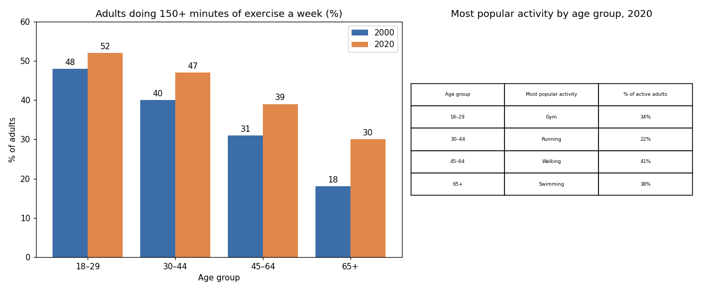
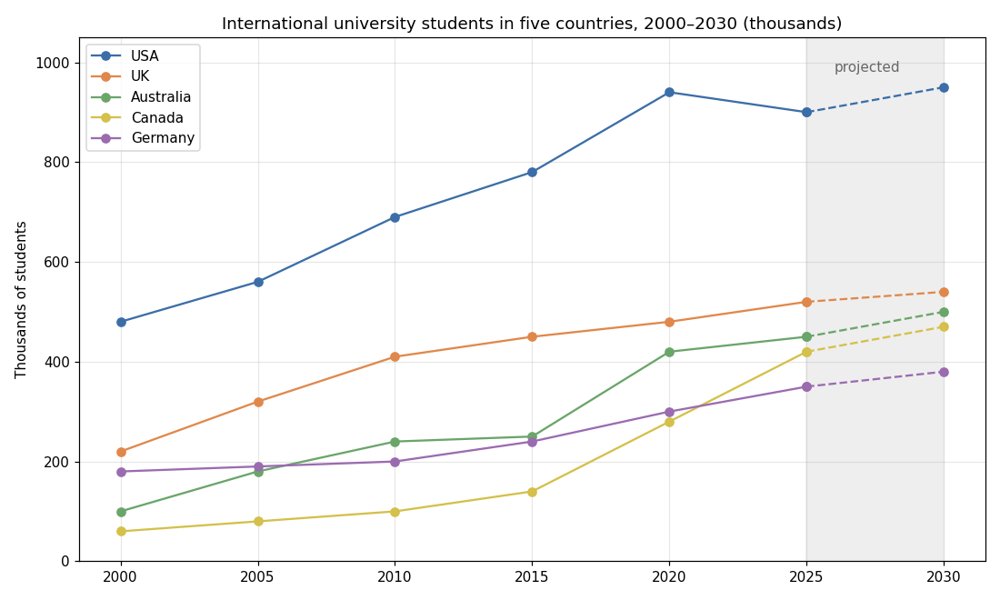
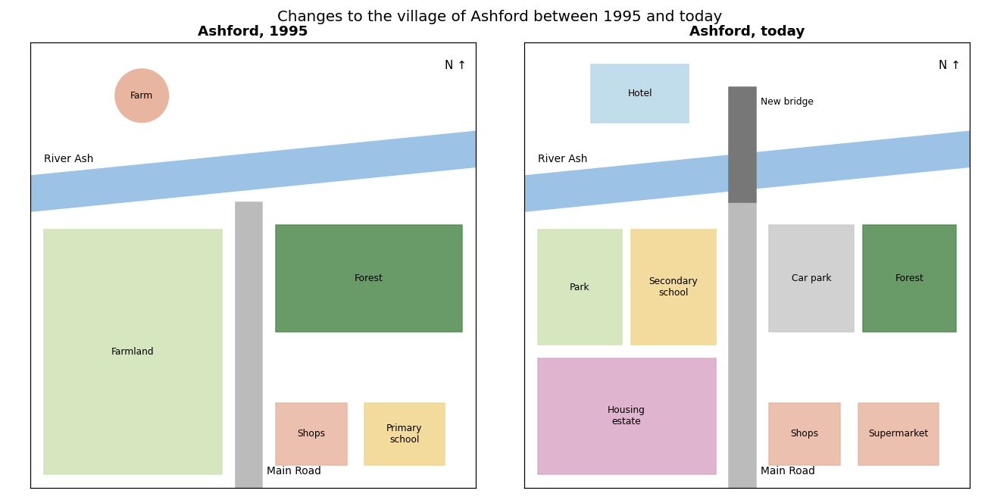
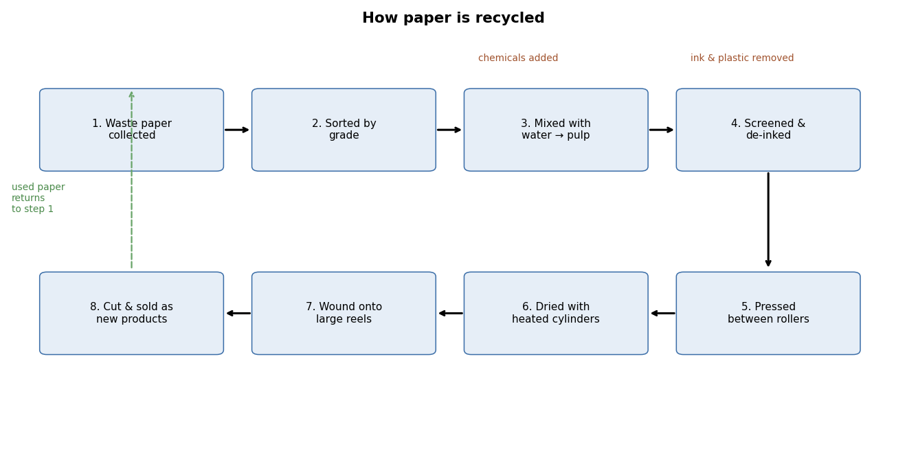

# 📊 Banco de Task 1: 5 visuales originales con la complejidad real · ⏱️ 20 min · ≥150 palabras
*Gráficos y datos originales (CC BY 4.0), hechos con Python/matplotlib. Los visuales del examen real suelen tener **varios paneles, 4–6 categorías y datos que se cruzan**, así que estos también.*

---

## 1. Dos conjuntos de datos: cuatro tortas ⭐ (el tipo más frecuente)

> **The charts below show the sources of energy used in homes in two cities, Northbridge and Southvale, in 2005 and 2025.**
> **Summarise the information by selecting and reporting the main features, and make comparisons where relevant. Write at least 150 words.**

💡 Overview modelo

*Overall, both cities moved away from oil and towards solar power and electricity over the 20-year period. While gas was the main energy source in Northbridge in 2005, electricity had become the largest source in both cities by 2025.*

**Datos clave:** el oil se desploma en las dos (15→4 y 30→12) · el solar es lo que más sube (2→18 y 5→25) · el gas baja en Northbridge (45→30) pero se mantiene en Southvale (20→22).
**Organización:** Body 1 = Northbridge · Body 2 = Southvale (o Body 1 = lo que sube · Body 2 = lo que baja).

## 2. Dos conjuntos de datos: barras + tabla

> **The bar chart shows the percentage of adults in one country who did at least 150 minutes of exercise a week in 2000 and 2020, by age group. The table shows the most popular activity for each age group in 2020.**
> **Summarise the information by selecting and reporting the main features, and make comparisons where relevant. Write at least 150 words.**

💡 Overview modelo

*Overall, the proportion of active adults rose in every age group, with the largest increase among people aged 65 and over, although younger adults remained the most active. The preferred activity varied considerably with age, from the gym among the youngest group to walking and swimming among older people.*

**Trampa:** la tabla es **% de los adultos activos**, no de todos los adultos. **Conectar** los dos visuales en el overview.

## 3. Gráfico de líneas: 5 líneas, cruces y proyección

> **The graph below shows the number of international university students in five countries between 2000 and 2020, with projections to 2030.**
> **Summarise the information by selecting and reporting the main features, and make comparisons where relevant. Write at least 150 words.**

💡 Overview modelo

*Overall, all five countries attracted more international students over the period, and the USA remained by far the most popular destination throughout. Canada showed the most dramatic growth, overtaking Germany and almost catching up with Australia, and this upward trend is expected to continue to 2030.*

**Trampas:** la proyección va en **futuro** (*is expected / predicted to reach*) · EE. UU. **baja** entre 2020 y 2025 (940→900) · Canadá (60→470) supera a Alemania entre 2020 y 2025, pero **no** a Australia · son **miles** (*480,000 students*).

## 4. Mapa: antes y ahora

> **The maps below show the village of Ashford in 1995 and today.**
> **Summarise the information by selecting and reporting the main features, and make comparisons where relevant. Write at least 150 words.**

💡 Overview modelo

*Overall, Ashford has been transformed from a largely rural village into a more developed residential area, with the farmland replaced by housing and new facilities. The road network has also been extended across the river, while the forest has been reduced in size.*

**Gramática del mapa:** **pasiva** en presente perfecto (*has been replaced / was demolished / has been built*) · ubicación (*to the west of the main road, north of the river*) · lo que **no cambió** (shops).
**Cambios:** granja → hotel · farmland → housing estate + park + secondary school · parte del forest → car park · primary school → supermarket · new bridge.

## 5. Proceso: reciclaje de papel

> **The diagram below shows how paper is recycled.**
> **Summarise the information by selecting and reporting the main features. Write at least 150 words.**

💡 Overview modelo

*Overall, there are eight stages in the process, beginning with the collection of waste paper and ending with the sale of new paper products. The process is cyclical, as these products can later be collected and recycled again.*

**Gramática del proceso:** **pasiva en presente** (*is collected, is mixed, are removed*) · secuenciadores (*First, After that, Once…, Finally*) · **no** hay datos que comparar: no inventar opiniones.

---

## ✅ Checklist de Task 1
- ☐ Intro = paráfrasis de la consigna (no copiar)
- ☐ **Overview** justo después: 2 rasgos principales, **sin números**
- ☐ Cifras en **dígitos** y comprobadas una por una
- ☐ % → *proportion / share*, no *number* · miles → *thousand*
- ☐ Tiempo verbal: pasado (datos), futuro (proyección), pasiva (mapa/proceso)
- ☐ Sujeto en cada verbo · releer la frase entera
